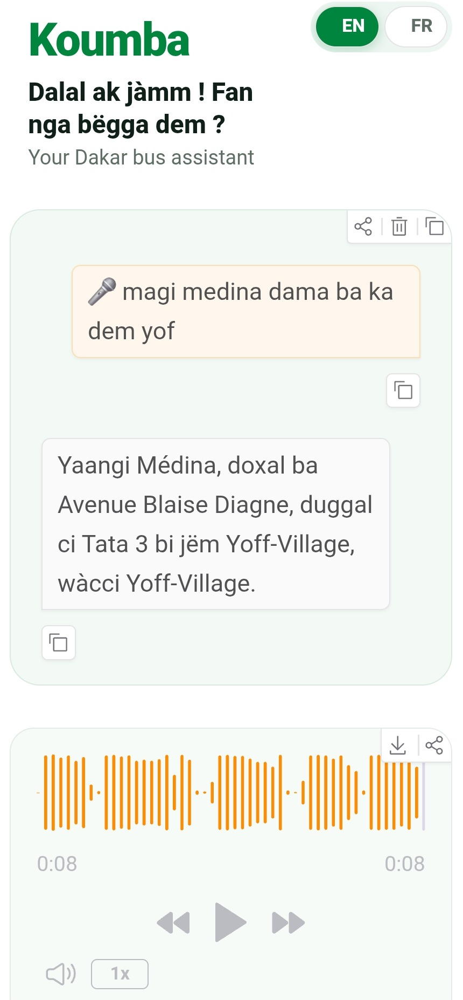
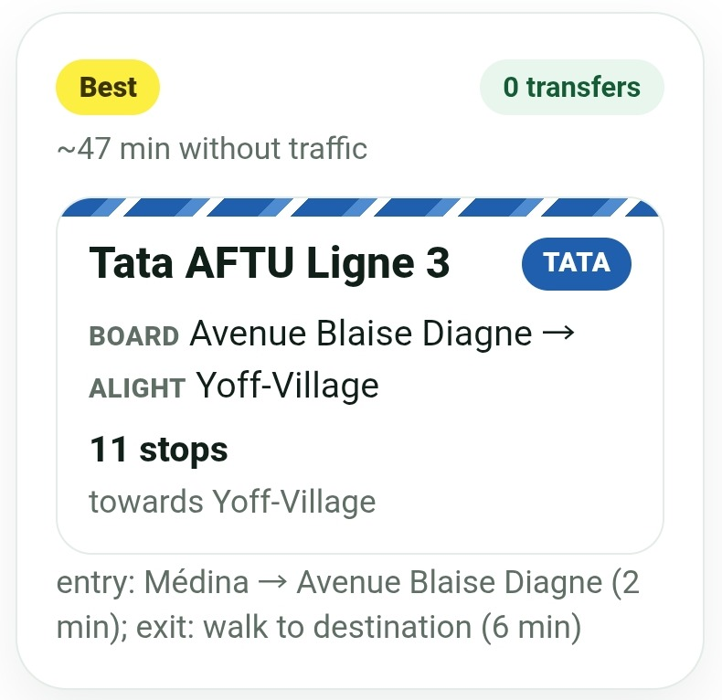
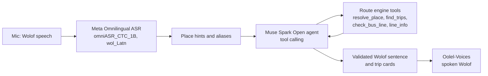

# 🚌 Koumba

### Wolof voice agent that tells Dakar riders which bus to take

[](https://www.python.org/)
[](https://www.gradio.app/)
[](https://ai.meta.com/)
[](https://www.baseten.co/)
[](https://cheikhniang159--koumba-web-web.us-east.modal.run)
[](LICENSE)

## 📑 Table of contents

- [📋 Context & problem](#-context--problem)
- [🎯 Solution](#-solution)
- [📸 Preview](#-preview)
- [🦙 How it uses Meta models](#-how-it-uses-meta-models)
- [🧭 Architecture](#-architecture)
- [🗣️ Wolof, by a native speaker](#-wolof-by-a-native-speaker)
- [📊 Key results](#-key-results)
- [🕰️ Built before vs during the hackathon](#-built-before-vs-during-the-hackathon)
- [⚠️ Limitations](#-limitations)
- [🚀 Run it yourself](#-run-it-yourself)
- [🔮 Next steps](#-next-steps)
- [👨‍💻 Author](#-author)
- [📄 License](#-license)
- [🙏 Acknowledgements](#-acknowledgements)

---

## 📋 CONTEXT & PROBLEM

Koumba tells people in Dakar which bus to take, by voice, in Wolof. It was built
for the **Meta Global AI Developer Hackathon**, Indie track, theme **"Build for
Your World"**.

Many bus riders in Dakar speak Wolof and cannot read. The information they need
is spread across different sources and is not always written in the language
they use. Tata AFTU minibuses and Dakar Dem Dikk buses serve overlapping routes,
and a rider often has to ask people at the stop.

---

## 🎯 SOLUTION

Koumba answers out loud. It takes a spoken Wolof question, finds a route from the
public line data, and speaks a short answer. The screen shows the same route as
simple trip cards.

**Live demo:** **https://cheikhniang159--koumba-web-web.us-east.modal.run**

The first load after a quiet period can take about 30 seconds while the CPU
containers wake up. The app is a phone-sized web page. Tap the microphone and
ask in Wolof, French, or English, or type your question.

---

## 📸 PREVIEW

<table>
  <tr>
    <td align="center"><br><sub>Voice answer</sub></td>
    <td align="center"><br><sub>Trip cards</sub></td>
  </tr>
</table>

---

## 🦙 HOW IT USES META MODELS

| Part | Model | What it does |
| --- | --- | --- |
| Speech to text | Meta Omnilingual ASR, `omniASR_CTC_1B`, language `wol_Latn` | Turns a Wolof recording into text on Modal CPU. |
| Agent and vision | Muse Spark Open, `meta-models/muse-spark-open-1026` on Baseten | Calls route tools, chooses an answer, and reads a bus photo to identify the operator and line. |

The other parts are clearly non-Meta:

| Part | Model or code | Why it is used |
| --- | --- | --- |
| Spoken Wolof reply | Oolel-Voices by `soynade-research`, licensed AGPL-3.0 | No Meta model speaks Wolof yet, so this model generates the audio. |
| Route engine | Our own Python code: Dijkstra search with at most two transfers | Finds bus legs, walking links, and transfers from the public dataset. |

---

## 🧭 ARCHITECTURE



---

## 🗣️ WOLOF, BY A NATIVE SPEAKER

The Wolof answers were checked by a native speaker. Koumba uses reviewed
sentence templates instead of free-form spoken text, so the spoken answer stays
short and predictable.

The voice spellings are separate from the displayed names. For example:

- `Sahm` is spoken as `Saam`
- `Ouakam` is spoken as `Wakaam`
- `PAI` is spoken as `Paay`

Koumba does not speak travel times. Dakar traffic changes too much for a spoken
estimate to be useful; times are only shown as a small hint on the cards.

When a place is ambiguous, Koumba asks a short spoken question with two choices.
The rider can answer by voice or tap one of the two large buttons.

---

## 📊 KEY RESULTS

From live tests on the demo:

- ✅ **Warm text answer:** about **12 seconds** in total, with about **5.6 seconds** for ASR and about **7 seconds** for the agent, using **1 LLM call**.
- ✅ **New spoken sentence:** about **10-30 seconds** on CPU.
- ✅ **Cached spoken sentence:** returned instantly.
- ✅ **Test suite:** **281 tests**, using fakes only: no real model calls, no real voice calls, and no network access to Modal.

Recordings and photos are not stored. Audio is used only for transcription, and
the bus photo is used only for the current turn.

---

## 🕰️ BUILT BEFORE VS DURING THE HACKATHON

| Before the hackathon | During the hackathon |
| --- | --- |
| The public dataset `TIJAANI/dakar-bus-network`, containing AFTU and Dakar Dem Dikk line information. | Everything else in this repository, written during Oct 26 - Nov 4, 2026. |

---

## ⚠️ LIMITATIONS

- The public dataset is incomplete. Some lines only list their termini, and some stops have no coordinates.
- Koumba does not use live traffic, live schedules, or fares.
- Voice reply generation runs on CPU and is slow for new sentences.
- Oolel-Voices is licensed AGPL-3.0. That license applies to the voice model and service, not to Koumba's MIT-licensed code.
- New Hugging Face Spaces require Hugging Face PRO, so the public demo runs on Modal instead.

---

## 🚀 RUN IT YOURSELF

Koumba needs Python 3.12.

```powershell
python -m venv .venv
.\.venv\Scripts\Activate.ps1
pip install -r requirements.txt
```

Copy `.env.example` to `.env` and fill in your own values. These are the variable
names only; no secrets are included in this repository:

- `KOUMBA_BASE_URL`
- `KOUMBA_API_KEY_ENV`
- `KOUMBA_MODEL`
- `BASETEN_API_KEY` (or the key name set in `KOUMBA_API_KEY_ENV`)
- `KOUMBA_ASR_URL`
- `KOUMBA_ASR_KEY`
- `KOUMBA_TTS_URL`

Start the local app:

```powershell
python -m koumba.app
```

Run the tests:

```powershell
python -m pytest -q
```

The suite has **281 tests**. They use fakes only: no real model calls, no real
voice calls, and no network access to Modal.

### Deploy on Modal

Create the shared voice secret and the Hugging Face secret, then deploy the ASR
and TTS services. Use your own random values and tokens.

```powershell
python -m modal secret create koumba-asr "KOUMBA_ASR_KEY=<random-value>"
python -m modal secret create koumba-hf "HF_TOKEN=<hugging-face-token>"
python -m modal deploy modal_app/asr.py
python -m modal deploy modal_app/tts.py
```

Put the ASR and TTS URLs in `.env`, then create the web secret from that file
and deploy the web app:

```powershell
python -m modal secret create koumba-app --from-dotenv .env --force
python -m modal deploy modal_app/web.py
```

The ASR service uses Modal CPU by default. Set `KOUMBA_ASR_DEVICE=gpu` before
deploying if you have a payment method and want GPU inference. See
`modal_app/README.md` for the endpoint checks and cold-start options.

For the long developer notes — architecture, route algorithm, tools, correction
format, assumptions, and test suite — see [`docs/TECHNICAL.md`](docs/TECHNICAL.md).

---

## 🔮 NEXT STEPS

- [ ] Add a trip mode that uses the phone GPS and announces the next stop.
- [ ] Collect Wolof voice data with consent to improve ASR for local accents and noisy street recordings.
- [ ] Add more field corrections from riders and drivers.
- [x] Spoken clarifications answerable by voice.

---

## 👨‍💻 AUTHOR

**Cheikh Niang** — Data Scientist, Dakar.

- 📧 [cheikhniang159@gmail.com](mailto:cheikhniang159@gmail.com)
- 💼 [LinkedIn](https://www.linkedin.com/in/cheikh-niang-5370091b5/)
- 🌐 [Portfolio](https://portfolio-cheikh-niang.vercel.app/)

---

## 📄 LICENSE

Koumba's code is licensed under the MIT License; see [`LICENSE`](LICENSE).

Oolel-Voices is licensed separately under AGPL-3.0. That license applies to the
voice model and service, not to Koumba's MIT-licensed code.

---

## 🙏 ACKNOWLEDGEMENTS

- **Meta** — Omnilingual ASR and Muse Spark Open.
- **soynade-research** — Oolel-Voices.
- **AFTU and Dakar Dem Dikk** — public line information.
- **Modal** — deployment for the demo, ASR, and TTS.
- **Baseten** — hosting for Muse Spark Open.
- **Cerebral Valley** — the Meta Global AI Developer Hackathon.

---

<div align="center">

**Koumba · Meta Global AI Developer Hackathon 2026 · Built in Dakar, for Dakar**

</div>
